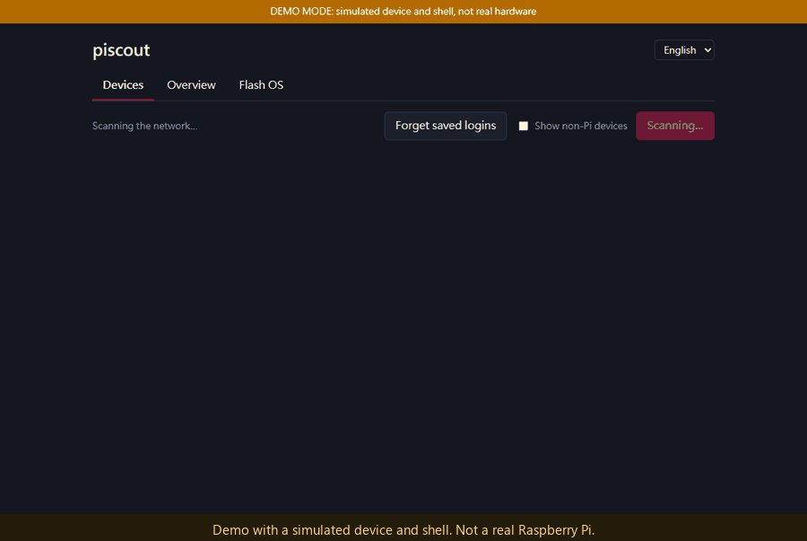
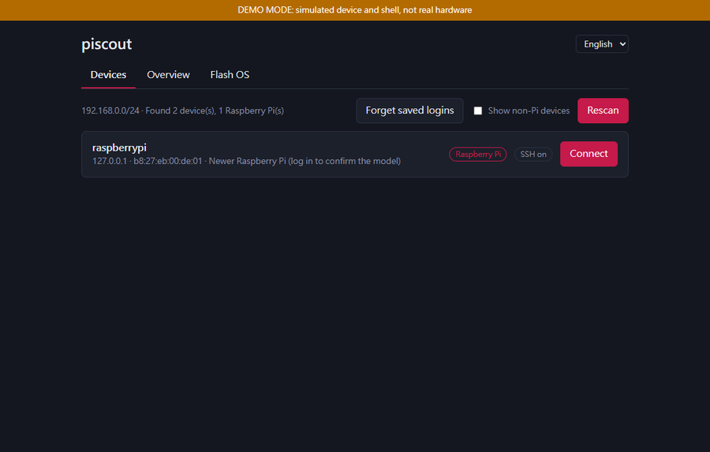
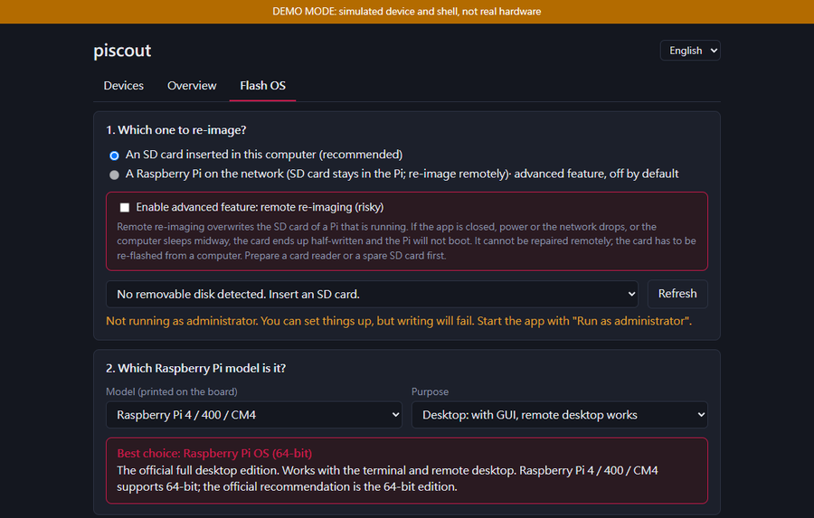

# piscout

**English** · [繁體中文](#繁體中文)

> Raspberry Pi LAN manager for Windows: auto-discovery, built-in SSH terminal, remote desktop, and remote re-imaging.

`raspberry-pi` `raspberry-pi-os` `network-scanner` `lan-discovery` `fleet-management`
`ssh-terminal` `remote-desktop` `vnc` `sd-card` `flasher` `imager` `netboot` `pxe`
`mdns` `fastapi` `pywebview` `windows` `desktop-app`



<sub>Recorded with a simulated device and shell (`PISCOUT_DEMO=1`, see [docs/DEMO.md](docs/DEMO.md)); no real Raspberry Pi appears in it.</sub>

Managing a few Raspberry Pis usually means digging IPs out of the router, opening SSH
windows and pulling SD cards to re-flash them. piscout puts all of that in one window:

- **Auto-discovery** – scans the LAN on launch and recognizes Raspberry Pis
- **Built-in terminal** – click *Connect*, enter the login, and get an SSH terminal inside the app
- **Remote desktop** – view and control the Pi's desktop through the SSH tunnel
- **Remote re-imaging (advanced, off by default)** – write a new OS to the Pi's own SD card without taking it out, with a recommended OS for the model. Read [Known risks](#known-risks) first
- **Local flashing** – or flash an SD card inserted into this computer
- **Overview and batch actions** – temperature / load / memory of every Pi at a glance; reboot, shut down or update several at once
- **Saved logins** – encrypted with Windows DPAPI; the model is detected automatically
- **Bilingual UI** – follows the system language (中文 / English), switchable at any time
- All OS images come from the official Raspberry Pi website and are verified with SHA-256

It is an early version. Scanning, SSH login, the terminal, remote desktop, the overview and
agent stats have been tested on a real Raspberry Pi 3 Model B; remote re-imaging and local
flashing still need real-device validation (see [Status](#status-and-roadmap)).

## Screenshots

| Devices | Flash OS (recommended image per model) |
|---|---|
|  |  |

The Devices screenshot uses the simulated device; the Flash OS screenshot uses the real official OS list.

## Usage

Download `piscout.exe` from [Releases](../../releases) (or build it yourself, see below) and run it.
Normal use (scanning, terminal, remote desktop, overview) does **not** need administrator rights.
Only *local SD card flashing* does, and the app offers a "Restart as administrator" button when
you get there. The file is not code-signed, so SmartScreen may warn you ("More info → Run anyway").

Packaging for **winget** and the **Microsoft Store** is being prepared (see [`packaging/`](packaging/)); until it is published, install from Releases. Not code-signed yet, hence the SmartScreen prompt.

**Remote re-imaging requires a Pi that still boots and has SSH enabled.** A completely
blank SD card cannot be seen on the network by any software; flash it once from this
computer, after which it can be re-imaged remotely.

How remote re-imaging works:

1. The PC downloads the official image and writes the boot settings straight into the image's boot partition while decompressing
2. `dd`, `dash` and `sha256sum` (with their libraries) are copied into the Pi's RAM (`/dev/shm`), so nothing depends on the SD card that is about to be overwritten
3. The image is streamed over SSH to the boot disk
4. The first part is read back and hashed; **the Pi only reboots if it matches**

> Overwriting the disk of a running system is inherently risky. If power or the network
> drops mid-write, the card will not boot and must be re-flashed from a computer.

## Run from source

Requires Python 3.9+, Windows 10/11 (WebView2 is built in on Windows 11).

```bash
git clone https://github.com/<your-account>/piscout.git
cd piscout
python -m venv .venv
.venv\Scripts\activate
pip install -r requirements.txt
python run_gui.py
```

Build an exe: `pip install pyinstaller` then `build.bat`. Run tests: `pytest`.

## How it differs from other tools

| Tool | Discovery | Terminal | Remote desktop | Flash | Re-image without removing the card |
|---|---|---|---|---|---|
| [Raspberry Pi Imager](https://github.com/raspberrypi/rpi-imager) | | | | local SD card | |
| Angry IP Scanner / nmap scripts | IP list only | | | | |
| Raspberry Pi Connect | | | cloud, account needed | | |
| **piscout** | ✓ | ✓ | ✓ | ✓ | ✓ |

piscout does not replace Imager. Imager writes an image to a card; piscout handles what
comes after the card is already in the Pi: find it, log in, see its screen, change its OS.

## Known risks

### Remote re-imaging can leave a card unbootable

This happened during the first real-hardware test, so it is documented here on purpose.

**What happened.** The app was closed while the image was still streaming to the Pi. The card was left partly overwritten. The Pi kept running from memory for a while (ping, the agent and VNC still answered) but every new SSH connection was dropped immediately, and after a power cycle it never came back on the network. The only fix was to re-flash the card from a computer with a card reader.

**Why it can happen.** Remote re-imaging overwrites the disk of a system that is running. Anything that interrupts the transfer (closing the app, the computer sleeping, a network or power drop) leaves a half-written card, and a Pi in that state cannot be repaired remotely.

**What the app does about it now**

- Remote re-imaging is an **advanced feature, off by default**. It is only enabled after you tick the switch on the *Flash OS* tab, and the backend refuses the request without that confirmation
- You must also confirm that you have a card reader or a spare SD card
- The computer is kept awake during the transfer and SSH keep-alive is enabled
- The image checksum is verified before anything is written, the first part of the card is read back and hashed, and **the Pi only reboots if it matches**
- If a failure happens after writing started, the app says the card needs to be re-flashed from a computer

**What you should do.** Use it only with a card reader or spare card within reach, on stable power, ideally with the PC on Ethernet and plugged in. Do not close the app until it reports success. If you do not have a reader, use *An SD card inserted in this computer* instead.

### Other things to know

- A completely blank card cannot be reached over the network by any software
- SSH host keys are trusted on first use (see Security notes)
- Remote desktop starts an unauthenticated VNC bound to `127.0.0.1` on the Pi while a session is open

## FAQ

**How do I find the IP address of a Raspberry Pi on my network from Windows?**
Open piscout; it scans your /24 on launch and flags Raspberry Pis by MAC prefix and mDNS name.

**Can I get an SSH terminal and a remote desktop for my Pi in one app?**
Yes. After logging in, the terminal (xterm.js) and the desktop (noVNC over an SSH tunnel) are tabs in the same window. The desktop needs Raspberry Pi OS with the Wayland desktop (wayvnc); Lite has no desktop.

**Can I reinstall Raspberry Pi OS without taking the SD card out?**
Yes, if the Pi still boots and SSH is enabled: piscout streams the official image over SSH to the Pi's own boot disk and verifies it before rebooting. It cannot help a blank card that has never booted; flash that one once from your computer.

**How does it choose which OS to install?**
It reads the model (from `/proc/device-tree/model` after login) and picks the matching official image: the 64-bit desktop edition for Pi 3 and newer, the 32-bit edition for older boards, or the Lite edition if you choose a terminal-only setup. It refuses an image the board cannot run.

**Is it a replacement for Raspberry Pi Imager?**
No. Use Imager to write a card in your computer. piscout is for managing Pis that are already on the network, and also includes a local flasher for convenience.

**Does it work on Linux or macOS?**
Not yet; the app and the local flasher target Windows. The scanner, terminal and remote-flash modules are plain Python and could be ported.

**Is it safe to expose?**
It binds to `127.0.0.1` only. Do not publish its port. See the security notes above.

## Security notes

- The UI service binds to `127.0.0.1` only; API calls need a per-launch random token, and terminal/desktop sessions use one-time tokens
- Passwords are stored with Windows DPAPI (bound to your Windows account and PC)
- SSH host keys are accepted on first use (`AutoAddPolicy`); harden this if you use it beyond a home LAN
- Remote desktop starts an unauthenticated VNC bound to `127.0.0.1` on the Pi, reachable only through the SSH tunnel, and stops it when the session closes
- Boot-settings passwords are stored hashed; the Wi-Fi password is plain text in the boot partition (format limitation)
- Only private IPs are accepted; images are only downloaded from Raspberry Pi domains
- Only scan networks you own

## Status and roadmap

**Tested on real hardware** (Raspberry Pi 3 Model B Rev 1.2, Raspberry Pi OS Debian 12 "Bookworm"):

| Feature | Result |
|---|---|
| LAN scan and Raspberry Pi detection | works |
| SSH login, system info, agent install, overview | works |
| Built-in terminal (run commands) | works (tested by the author) |
| Remote desktop (wayvnc through the SSH tunnel) | works (tested by the author) |

**Tested without a real device:** image pre-processing and boot-settings injection (also run against the real
Raspberry Pi OS 64-bit image: source SHA-256 verified, `user-data` written into the boot partition), the Pi-side
write script's flow and verification (simulated locally), unit tests.

Have a different model or OS version? Please [report a compatibility result](../../issues/new/choose); it makes this table better.

**Not yet verified on real hardware:** a completed remote write (the first real attempt was interrupted, see Known risks) and local SD flashing.

- [ ] Validate the three items above on real devices and publish the results per model
- [ ] Network install (netboot) for blank cards: works out of the box on Pi 3B+, needs a one-time bootloader change on Pi 4/5
- [ ] Remote desktop for X11 / RealVNC systems
- [ ] SSH host-key pinning
- [ ] Linux / macOS local flashing

---

<a id="繁體中文"></a>

# piscout（繁體中文）

[English](#piscout) · **繁體中文**

> Raspberry Pi 區網管理工具：自動掃描、內建 SSH 終端機、遠端桌面、遠端重灌系統。
> A Windows desktop tool to discover, SSH into, view the desktop of, and re-image Raspberry Pis on your LAN.

`raspberry-pi` `raspberry-pi-os` `network-scanner` `lan-discovery` `fleet-management`
`ssh-terminal` `remote-desktop` `vnc` `sd-card` `flasher` `imager` `netboot` `pxe`
`mdns` `fastapi` `pywebview` `windows` `desktop-app`


<sub>示範影片使用模擬的裝置與終端機錄製（`PISCOUT_DEMO=1`，說明見 [docs/DEMO.md](docs/DEMO.md)），畫面中沒有真實的樹莓派。</sub>

家裡有好幾台樹莓派，每次都要去路由器後台翻 IP、開 SSH 視窗、插拔 SD 卡重灌，
很煩。所以寫了這個 Windows 桌面程式，把這些事放在同一個視窗裡：

- **自動掃描**：一打開就掃區網，找出樹莓派
- **內建終端機**：點「連線」輸入帳密，直接在程式裡開 SSH 終端機，不用另外開視窗
- **遠端桌面**：一鍵看到樹莓派的桌面畫面並操作（走 SSH 通道）
- **遠端重灌（進階功能，預設關閉）**：SD 卡不用拔，從電腦直接把新系統寫進 Pi 的卡，並依型號給出最佳建議。使用前請先看[已知風險](#已知風險)
- **本機燒錄**：也可以把 SD 卡插在電腦上燒錄
- **總覽與批次操作**：多台 Pi 的溫度、負載、記憶體一覽，勾選後可批次重開機、關機、更新套件
- **記住帳密**：以 Windows DPAPI 加密儲存，下次自動填入、自動偵測型號
- **雙語介面**：自動偵測系統語言（中文 / English），也可手動切換
- 系統映像全部來自樹莓派官方網站，會校驗 SHA-256


目前還是早期版本，終端機與掃描有實測，遠端桌面和遠端重灌還需要更多實機驗證（見最下面）。

## 使用

到 [Releases](../../releases) 下載 `piscout.exe` 雙擊即可（尚未發佈時請依下方「從原始碼執行」自行打包）。
一般使用（掃描、終端機、遠端桌面、總覽）不需要系統管理員權限；只有「本機燒錄」寫入 SD 卡時，才會請你以系統管理員身分重新啟動。

> 檔案沒有簽章，SmartScreen 可能警告，按「其他資訊 → 仍要執行」。

**winget** 與 **Microsoft Store** 的上架準備中（見 [`packaging/`](packaging/)），在發佈之前請從 Releases 下載。目前尚未簽章，所以會看到 SmartScreen 提示。

### 連線、終端機、遠端桌面

開啟後會自動掃描。找到的樹莓派按「連線」，輸入帳號密碼，就會在程式裡開出終端機。
上方可以切換：

- **終端機**：完整的 xterm，支援縮放視窗
- **遠端桌面**：在 Pi 上啟動只監聽 `127.0.0.1` 的 wayvnc，再經 SSH 通道轉到程式裡顯示。
  需要 Raspberry Pi OS 桌面版（Wayland），Lite 版沒有桌面所以不行
- **系統資訊**：型號、溫度、記憶體、磁碟，並可安裝監控用的 agent

勾選「記住」時，帳密會以 Windows DPAPI 加密存在這台電腦（只有同一個 Windows 帳號解得開）；沒勾就只存在這個視窗的記憶體裡，關閉連線就沒了。可以用「清除已存帳密」全部刪除。

### 遠端重灌（SD 卡留在 Pi 上）

1. 到「燒錄系統」，選區網裡的樹莓派，填它**目前**的登入帳密
2. 按「讀取這台的型號與系統」，會自動選對型號並顯示最佳建議
3. 設定重灌後的主機名稱、帳號、密碼、Wi-Fi
4. 按兩次「開始燒錄」（第一次只是確認），等 10–30 分鐘，Pi 會自己重新開機

**前提：Pi 必須還開得起來、而且開著 SSH。** 完全空白的 SD 卡在網路上根本看不到，
沒有任何軟體能遠端連上它。這種情況請改用「插在這台電腦上的 SD 卡」。

運作方式：

1. 電腦端下載官方映像，解壓縮時把開機設定直接寫進映像裡的 boot 分割區
2. 把 `dd`、`dash`、`sha256sum` 連同函式庫複製到 Pi 的記憶體（`/dev/shm`），
   之後只用記憶體裡的程式，不再依賴會被覆蓋的 SD 卡
3. 映像串流經 SSH 寫入 Pi 的開機磁碟
4. 讀回前段資料算 SHA-256，**一致才重新開機**；不一致就停下來並報錯

> 這是在「正在執行的系統」上覆寫它自己的磁碟，天生有風險。寫到一半斷電或斷網，
> 那張卡就開不了機，得拔下來用電腦重燒。請在穩定的電源與網路下進行。

### 本機燒錄

「燒錄系統」選「插在這台電腦上的 SD 卡」。只列出 USB/SD 類的可移除磁碟，
不會列出系統碟，也不會列出超過 512 GB 的磁碟。

## 和其他工具的差別

| 工具 | 掃描 | 內建終端機 | 遠端桌面 | 燒錄 | 遠端重灌（不拔卡） |
|---|---|---|---|---|---|
| [Raspberry Pi Imager](https://github.com/raspberrypi/rpi-imager)（官方） | | | | 本機 SD 卡 | |
| Angry IP Scanner、各種 nmap 腳本 | ✓ 只列 IP | | | | |
| [LabLink](https://github.com/X9X0/LabLink) 等 Pi 掃描工具 | ✓ | | | | |
| Raspberry Pi Connect（官方） | | | ✓ 需帳號、走雲端 | | |
| **piscout** | ✓ | ✓ | ✓ | ✓ | ✓ |

piscout 不是要取代 Imager：Imager 是把映像寫進一張卡，piscout 處理的是「卡已經在
Pi 上」之後的事——找到它、連進去、看畫面、換系統。網路開機安裝（netboot）的相關
專案可以參考 [pipxe](https://github.com/ipxe/pipxe)、
[rpi-pxe-server](https://github.com/beta-tester/install-pxe-server)，
這部分 piscout 還在規劃中。

## 已知風險

### 遠端重灌可能讓卡變成開不了機

這件事在第一次真機測試時發生了，所以刻意寫在這裡。

**發生了什麼。** 映像還在傳輸時程式被關掉，卡被覆寫到一半。樹莓派有一段時間還靠記憶體運作
（ping、agent、VNC 都還有回應），但每個新的 SSH 連線都被立刻切斷，重新通電後再也沒有回到網路上。
唯一的解法是把卡拿到有讀卡機的電腦上重燒。

**為什麼會這樣。** 遠端重灌是在「執行中」的系統上覆寫它自己的磁碟。任何中斷（關閉程式、電腦睡眠、
斷網、斷電）都會留下寫了一半的卡，而且這種狀態無法從遠端修復。

**現在程式做了哪些防護**

- 遠端重灌是**進階功能，預設關閉**，要在「燒錄系統」頁勾選開關才會啟用；後端沒有收到確認也會拒絕
- 還必須確認你有讀卡機或備用的 SD 卡
- 傳輸期間禁止電腦睡眠，並啟用 SSH 保持連線
- 寫入前先校驗映像，寫完讀回前段資料算 SHA-256，**一致才會重新開機**
- 如果在開始寫入之後失敗，會明確提示這張卡要拿到電腦上重燒

**你該怎麼做。** 只在讀卡機或備用卡就在手邊、電源穩定的時候使用，最好電腦接網路線並插著電源。
程式回報成功之前不要關掉它。沒有讀卡機的話，請改用「插在這台電腦上的 SD 卡」。

### 其他要注意的

- 完全空白的卡在網路上看不到，沒有任何軟體能遠端連上它
- SSH 的 host key 是「第一次連線就信任」（見安全注意事項）
- 開著遠端桌面連線時，Pi 上會有一個只聽 `127.0.0.1`、沒有密碼的 VNC

## 常見問題

**Windows 上怎麼找到區網裡樹莓派的 IP？**
打開 piscout 就會自動掃描 /24 網段，用 MAC 前綴與 mDNS 名稱標出樹莓派。

**能在同一個程式裡開 SSH 終端機和遠端桌面嗎？**
可以。登入後終端機（xterm.js）和桌面（noVNC，走 SSH 通道）是同一個視窗的分頁。
遠端桌面需要 Raspberry Pi OS 桌面版（Wayland / wayvnc），Lite 沒有桌面。

**不拔 SD 卡可以重灌系統嗎？**
可以，前提是 Pi 還開得起來而且開著 SSH：piscout 會把官方映像經 SSH 串流寫進 Pi 自己的
開機磁碟，並在重新開機前校驗。**從未開機過的空白卡做不到**，那種卡請先在電腦上燒一次。

**它怎麼決定要裝哪個系統？**
登入後讀取 `/proc/device-tree/model` 得知型號，挑對應的官方映像：Pi 3 以後建議 64 位元桌面版，
更舊的板子用 32 位元版，選精簡用途就推薦 Lite。板子跑不起來的映像會直接拒絕。

**能取代 Raspberry Pi Imager 嗎？**
不能。Imager 負責把卡寫好；piscout 負責卡已經在 Pi 上之後的管理，也附了方便的本機燒錄。

**支援 Linux / macOS 嗎？**
目前只支援 Windows（含本機燒錄）。掃描、終端機、遠端重灌都是純 Python，之後可以移植。

## 從原始碼執行

需要 Python 3.9 以上、Windows 10/11（需要 WebView2，Win11 內建）。

```bash
git clone https://github.com/<你的帳號>/piscout.git
cd piscout
python -m venv .venv
.venv\Scripts\activate
pip install -r requirements.txt
python run_gui.py
```

本機燒錄寫入 SD 卡需要系統管理員權限；程式會在需要時提供「以系統管理員身分重新啟動」按鈕。

打包成 exe：

```bash
pip install pyinstaller
build.bat
```

## 專案結構

```
run_gui.py            # 桌面版入口
build.bat             # PyInstaller 打包
piscout/
├── gui.py            # 原生視窗（pywebview）+ 只聽 127.0.0.1 的本機服務
├── app.py            # FastAPI：API、終端機與桌面的 WebSocket
├── scanner.py        # 區網掃描、ARP 解析、mDNS
├── remote.py         # SSH 連線、啟動遠端桌面、安裝 agent
├── remoteflash.py    # 遠端重灌
├── flasher.py        # 映像清單、型號建議、本機燒錄、開機設定
├── agent/agent.py    # 會被推到 Pi 上的小程式（只用標準函式庫）
└── static/           # 介面；vendor/ 內是 xterm.js 與 noVNC
tests/
```

跑測試：`pytest`

## 注意事項

- 介面服務只綁 `127.0.0.1`，並使用一次性 token 建立終端機/桌面連線
- SSH 的 host key 目前是「第一次連線就接受」，家用網路還好，正式環境請自己改
  （`remote.py` 的 `AutoAddPolicy`）
- 遠端桌面會在 Pi 上開一個**無密碼、只聽本機**的 VNC，因為只能經由 SSH 通道連到，
  所以安全性等同 SSH；關閉連線時會把它停掉
- 開機設定裡的密碼只寫雜湊值；Wi-Fi 密碼因為格式限制會以明文寫在 boot 分割區
- API 只接受私有網段的 IP；映像只下載樹莓派官方網域
- 只掃自己的網路

## 驗證狀況與還沒做的

**已在真機實測**（Raspberry Pi 3 Model B Rev 1.2、Raspberry Pi OS Debian 12「Bookworm」）：區網掃描與 Pi 辨識、
SSH 登入與系統資訊、agent 安裝與總覽、內建終端機（可實際執行指令）、遠端桌面（經 SSH 通道的 wayvnc），皆由作者測試。

**未用真機測試的部分**：映像預處理與開機設定寫入（含用真實的 Raspberry Pi OS 64 位元映像跑過：來源 SHA-256 校驗通過、`user-data` 已寫入 boot 分割區）、
Pi 端寫入腳本的流程與校驗邏輯（用本機模擬）、單元測試。

**還沒在真機上實測**：遠端重灌的完整寫入（第一次真機嘗試中途被中斷，見「已知風險」）、本機 SD 卡燒錄。

你用的是別的型號或系統版本嗎？歡迎[回報相容性結果](../../issues/new/choose)。
Pi 專屬的部分（記憶體內執行環境、sysrq 重開機、wayvnc）是依文件寫的，
第一次實機測試很可能需要微調。

- [ ] 實機驗證以上三項，並補上各型號的測試結果
- [ ] 遠端桌面支援 X11 / RealVNC 的舊系統
- [ ] SSH key 登入的介面（後端已支援，前端還沒接）
- [ ] Linux / macOS 的本機燒錄
- [ ] 空白 Pi 用 PXE / 網路開機安裝

## 已知問題

- Windows 防火牆有時會擋掉 mDNS，主機名稱會是空的，但 IP 與 MAC 判斷正常
- 掃描只做 IPv4，而且只掃 /24
- 用了 USB 網卡等非原廠網卡，MAC 前綴會對不上
- 本機燒錄後 Windows 可能會跳出「需要格式化磁碟」，**不要格式化**，直接關掉
